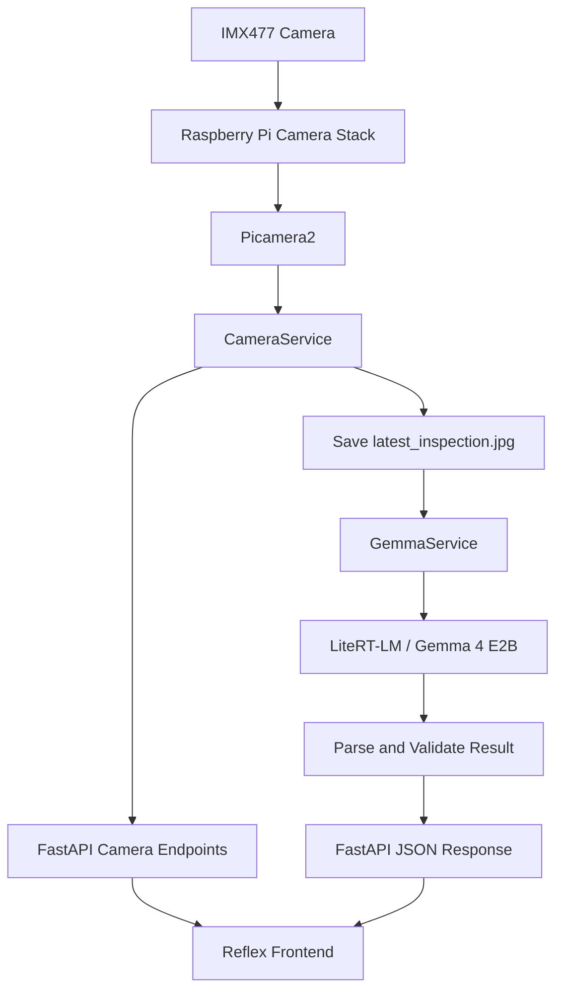

<div align="center">

# AIScanner
### Offline Multimodal Edge AI Crop Inspection

Inspect supported crops locally with a Raspberry Pi camera and on-device Gemma vision inference.


</div>

---

## Overview

**AIScanner** is an edge-AI crop inspection application built around a Raspberry Pi 5, an IMX477 camera, Gemma 4 E2B, LiteRT-LM, FastAPI, and a Reflex frontend.

The application captures an image, runs vision inference locally, and returns a structured visual quality assessment. Inspection images are processed on the device rather than sent to a cloud inference service.

### Supported crops

| Crop | Example checks |
|---|---|
| Yam | Visible mold, rot, discoloration, bruising, damaged skin, and abnormal texture |
| Sweet potato | Visible mold, rot, discoloration, bruising, damaged skin, and abnormal texture |
| Orange | Visible mold, fuzzy growth, rot, dark spots, bruising, and abnormal texture |

Images that do not contain a supported crop are intended to return `UNKNOWN` for the crop and condition, with `UNSUPPORTED IMAGE` as the defect value.

> **Important:** AIScanner provides an AI-assisted assessment of visible features. It cannot determine internal damage that is not visible in the image and should not be treated as a food-safety guarantee.

## Current project status

- [x] IMX477 camera tested with the Raspberry Pi camera stack and Picamera2.
- [x] FastAPI single-frame and MJPEG stream endpoints tested.
- [x] Camera-driven Gemma inspection endpoint tested.
- [x] Home, Inspection, and Settings pages created in Reflex.
- [ ] Connect and verify every frontend action and settings control against the backend.
- [ ] Add persistent inspection history and deployment hardening.

The frontend's presence does not necessarily mean each control is connected to the backend. Check the implementation and test the current version before relying on a control.

## Features

- **On-device vision inference** — loads Gemma 4 E2B locally through LiteRT-LM using the CPU backend.
- **Raspberry Pi camera integration** — captures images from an IMX477 camera through Picamera2 and the system libcamera stack.
- **Live camera preview** — exposes a continuously updating MJPEG stream.
- **Inspection capture** — saves the latest image submitted for inference so it can be viewed separately from the live preview.
- **Crop condition assessment** — prompts the model to identify visible defects such as mold, rot, decay, bruising, discoloration, spots, damaged skin, and abnormal texture.
- **Structured API response** — returns the crop, condition, defect description, image path, elapsed inference time, and visual-token budget.
- **Reflex interface** — organizes the user interface into Home, Inspection, and Settings pages.

## System architecture



Camera preview and AI inspection are separate operations. The preview can continue while the model processes one captured image. Inference takes several seconds per image on the target device, so the application should not run an inference for every preview frame.

## Technology stack

| Component | Technology |
|---|---|
| Target hardware | Raspberry Pi 5 |
| Camera | Raspberry Pi HQ Camera / compatible IMX477 module |
| Operating system | Raspberry Pi OS 64-bit, Debian 13-based development environment |
| Python | Python 3.13 |
| Environment and dependencies | `uv` |
| Camera interface | Picamera2, libcamera, Raspberry Pi camera utilities |
| Vision model runtime | LiteRT-LM 0.16.1 |
| AI model | Gemma 4 E2B instruction-tuned vision model |
| Backend | FastAPI and Uvicorn |
| Frontend | Reflex 0.9.8.post1 |

Package versions may vary between environments. In particular, the native `libcamera` Python binding should be provided by the Raspberry Pi OS packages and be accessible to the backend virtual environment.

## Repository structure

```text
AIScanner/
├── backend/
│   ├── api/
│   │   ├── camera.py                 # Camera frame, stream, and inspection-image routes
│   │   ├── health.py                 # Health routes, if registered
│   │   ├── inference.py              # Gemma inspection endpoint and prompt
│   │   └── system.py                 # System routes, if registered
│   ├── config/
│   │   └── settings.py               # Backend configuration
│   ├── models/
│   │   └── schemas.py                # API data schemas
│   ├── services/
│   │   ├── camera_service.py         # Picamera2 lifecycle, capture, and frames
│   │   ├── gemma_service.py          # LiteRT-LM engine and image inference
│   │   └── metrics_service.py        # Timing/performance helpers
│   ├── main.py                       # FastAPI app and service lifecycle
│   ├── test_camera_service.py
│   ├── test_gemma_budget.py
│   ├── test_gemma_service.py
│   ├── test_gemma_vision.py
│   ├── pyproject.toml
│   └── uv.lock
├── data/
│   ├── captures/                     # Latest inspection image
│   └── logs/                         # Intended application log directory
├── frontend/
│   ├── assets/                       # UI images and icons
│   ├── pages/
│   │   ├── home.py                   # Home page
│   │   ├── inspection.py             # Camera and inspection UI
│   │   └── settings.py               # Settings UI
│   ├── state/
│   │   └── inspection_state.py       # Reflex state and events
│   ├── main.py                       # Reflex app and routes
│   ├── rxconfig.py                   # Reflex configuration
│   ├── pyproject.toml
│   └── uv.lock
├── models/
│   └── gemma-4-E2B-it.litertlm/       # Local model directory; do not commit weights
├── scripts/                          # Utility scripts
├── test_images/                      # Manual and test images
├── tests/
│   ├── backend/
│   └── frontend/
├── LICENSE
└── README.md
```

Python `__pycache__` directories and compiled `.pyc` files are generated automatically and should not be committed.

## Requirements

### Hardware

- Raspberry Pi 5.
- Raspberry Pi HQ Camera or compatible IMX477 camera module.
- Compatible CSI ribbon cable connected to a Raspberry Pi 5 camera connector.
- Power supply suitable for the Raspberry Pi and connected hardware.
- Display and browser for kiosk use, or another computer on the same network for development.
- Sufficient storage for the local Gemma model and its runtime cache files.

### Software

- Raspberry Pi OS 64-bit.
- Python 3.13-compatible project environment.
- `uv`.
- `python3-libcamera`, `python3-picamera2`, and Raspberry Pi camera utilities.
- Dependencies declared in the backend and frontend `pyproject.toml` files.

## Installation

The commands below assume the repository is located at `~/Documents/AIScanner` on the Raspberry Pi.

### 1. Install camera system packages

```bash
sudo apt update
sudo apt install -y \
  python3-libcamera \
  python3-picamera2 \
  libcamera-tools \
  rpicam-apps \
  libcap-dev
```

For additional I²C diagnostics when troubleshooting a camera:

```bash
sudo apt install -y i2c-tools
```

Make sure `uv` is installed and available in your terminal before continuing.

### 2. Verify the camera

List detected cameras:

```bash
rpicam-hello --list-cameras
```

The output should list the connected IMX477 camera. Test a still capture:

```bash
mkdir -p ~/Documents/AIScanner/test_images

rpicam-still \
  -o ~/Documents/AIScanner/test_images/camera_test.jpg \
  --width 320 \
  --height 240 \
  --nopreview
```

If no camera is listed, resolve the CSI cable, connector orientation, camera overlay, or sensor-detection issue before debugging the Python application.

### 3. Set up the backend environment

```bash
cd ~/Documents/AIScanner/backend
uv venv .venv --system-site-packages
uv sync
```

**Why `--system-site-packages` matters:** the backend needs access to the OS-provided `libcamera` Python binding. A virtual environment that cannot see this binding may raise `ModuleNotFoundError: No module named 'libcamera'` even if Picamera2 is installed.

Verify the imports:

```bash
uv run python - <<'PY'
import litert_lm
import libcamera
from picamera2 import Picamera2

print("LiteRT-LM: OK")
print("libcamera:", libcamera.__file__)
print("Picamera2: OK")
PY
```

### 4. Set up the frontend environment

```bash
cd ~/Documents/AIScanner/frontend
uv sync
uv run reflex --version
```

Run Reflex from the frontend directory. Keep the `app_name` and app-module configuration in `rxconfig.py` consistent with the entry point defined in `main.py`.

## Configuration

### Model path

The current setup uses a model directory similar to:

```text
/home/AIScanner/Documents/AIScanner/models/gemma-4-E2B-it.litertlm
```

If the repository is moved or the Linux username changes, update the path used by `backend/api/inference.py`, or centralize it in `backend/config/settings.py`.

The `.litertlm` model is a directory, not necessarily a single standalone file. LiteRT-LM may create cache files during initialization, so allow sufficient free storage. Do not commit model weights or generated model caches to source control.

### Inspection images

The latest inspection is stored under:

```text
data/captures/latest_inspection.jpg
```

The current workflow overwrites this file for each inspection. Unique filenames and a persistent inspection history are future improvements.

### Vision settings

The development configuration has used the following values:

| Setting | Example value |
|---|---:|
| CPU threads | `4` |
| Visual-token budget | `70` |
| Inspection image size | `320 × 240` |
| Output token budget | `48` |

These values are configured in the backend code. Do not assume that a dropdown on the Settings page changes the running model or camera unless it has been connected to Reflex state and a backend configuration endpoint and then tested.

### Frontend backend URL

The Inspection page may use a base URL such as:

```python
BACKEND_URL = "http://127.0.0.1:8000"
```

This works when the browser runs on the Raspberry Pi itself. If the frontend is opened on another computer, `127.0.0.1` refers to that computer. Replace it with the Raspberry Pi's LAN address, for example:

```python
BACKEND_URL = "http://192.168.1.50:8000"
```

Use the actual address assigned to your Raspberry Pi. Moving this value into an environment variable would make the deployment more portable.

## Run AIScanner

Start the backend and frontend in **separate terminal sessions**. Start the backend first.

### Terminal 1 — FastAPI backend

```bash
cd ~/Documents/AIScanner/backend
uv run uvicorn main:app --host 0.0.0.0 --port 8000
```

FastAPI initializes the camera and loads the Gemma engine during application startup. Initial model loading may take time. Use a single Uvicorn worker: this configuration shares one camera and one loaded model within a process, and multiple workers may compete for the camera and consume additional memory.

### Terminal 2 — Reflex frontend

```bash
cd ~/Documents/AIScanner/frontend
uv run reflex run
```

Open the frontend URL reported by Reflex. The development server commonly serves the UI at `http://127.0.0.1:3000`.

The FastAPI API uses port `8000`. Reflex may use port `8001` for its own development backend when `8000` is already occupied; this is expected. Keep the frontend's `BACKEND_URL` pointed at the FastAPI service.

### Frontend routes

| Route | Purpose |
|---|---|
| `/` | Home / start screen |
| `/inspection` | Live camera preview, inspection image, and result summary |
| `/settings` | Camera, AI, and system settings UI |

## Backend API

The interactive API documentation is available at [`http://127.0.0.1:8000/docs`](http://127.0.0.1:8000/docs). It is the best place to verify which routes are currently registered.

| Method | Endpoint | Purpose | Response |
|---|---|---|---|
| `GET` | `/` | API root/status | JSON |
| `GET` | `/health` | Basic health status | JSON |
| `GET` | `/api/test` | Simple test route | JSON |
| `GET` | `/api/camera/frame` | Capture/return one camera frame | JPEG image |
| `GET` | `/api/camera/stream` | Live camera preview | MJPEG stream |
| `GET` | `/api/camera/inspection` | Return the latest inspection image | JPEG image; may return `404` before a capture exists |
| `POST` | `/api/inference/inspect` | Capture a frame and run Gemma inspection | Structured JSON |

### Test a single frame

```bash
curl -f http://127.0.0.1:8000/api/camera/frame \
  --output /tmp/iscan-frame.jpg
file /tmp/iscan-frame.jpg
```

### View the live stream

Open this address in a browser on the Raspberry Pi:

[`http://127.0.0.1:8000/api/camera/stream`](http://127.0.0.1:8000/api/camera/stream)

The stream should remain open and show updating images.

### View the latest inspection image

Open:

[`http://127.0.0.1:8000/api/camera/inspection`](http://127.0.0.1:8000/api/camera/inspection)

This route returns the image currently saved as `data/captures/latest_inspection.jpg`. Run a new inspection to replace it.

### Trigger an inspection

The endpoint captures an image from the connected camera, passes it to Gemma, parses the response, and returns JSON. No request body is required for this camera-driven route.

```bash
curl -X POST http://127.0.0.1:8000/api/inference/inspect
```

## Inspection response

A supported-crop result has this general structure. The values below are illustrative; the crop result and inference time depend on the image and current runtime conditions.

```json
{
  "crop": "Orange",
  "condition": "DEFECTIVE",
  "defect": "Dark surface rot",
  "image": "/home/AIScanner/Documents/AIScanner/data/captures/latest_inspection.jpg",
  "elapsed_time": 9.33,
  "visual_token_budget": 70
}
```

An unsupported object is intended to return a normalized response such as:

```json
{
  "crop": "UNKNOWN",
  "condition": "UNKNOWN",
  "defect": "UNSUPPORTED IMAGE",
  "image": "/home/AIScanner/Documents/AIScanner/data/captures/latest_inspection.jpg",
  "elapsed_time": 8.81,
  "visual_token_budget": 70
}
```

### Output values

| Field | Expected values |
|---|---|
| `crop` | `Yam`, `Sweet Potato`, `Orange`, or `UNKNOWN` |
| `condition` | `GOOD`, `DEFECTIVE`, or `UNKNOWN` |
| `defect` | `NONE`, a short description of visible damage, or `UNSUPPORTED IMAGE` |
| `image` | Path of the saved inspection image |
| `elapsed_time` | Inference elapsed time reported by the backend |
| `visual_token_budget` | Visual-token budget used by the inspection service |

The model should report visible evidence only. Results can be affected by image quality, lighting, crop orientation, and colour reproduction.

## Testing

Run these checks from the project directories. The scripts are focused service/vision experiments and may need their input paths or configuration updated for the current device; they are not necessarily a complete automated test suite.

### Camera and Picamera2

```bash
cd ~/Documents/AIScanner/backend
uv run python -c "from picamera2 import Picamera2; print('Picamera2 OK')"
uv run python test_camera_service.py
```

Confirm that a capture is produced in the expected location and that it is a valid JPEG.

### Gemma vision experiments

```bash
cd ~/Documents/AIScanner/backend
uv run python test_gemma_service.py
uv run python test_gemma_vision.py
uv run python test_gemma_budget.py
```

### Frontend smoke test

Start Reflex and visit `/`, `/inspection`, and `/settings`. Check page navigation, image loading, browser developer-console errors, and network requests. Confirm that the browser can reach the configured backend address.

## Troubleshooting

<details>
<summary><strong>No cameras available</strong></summary>

1. Power off the Raspberry Pi before reseating the CSI ribbon cable.
2. Check cable orientation and connector latches at both ends.
3. Confirm which Pi 5 camera connector is in use and configure the corresponding camera overlay if manual configuration is required.
4. Inspect camera-related kernel messages:

   ```bash
   dmesg | grep -Ei 'imx477|rp1-cfe|csi|i2c|camera'
   ```

A sensor-probe message such as `failed to read chip id 477` with error `-121` indicates a communication issue below Python/FastAPI. Check the cable, connector, port configuration, and camera module.

</details>

<details>
<summary><strong><code>ModuleNotFoundError: No module named 'libcamera'</code></summary>

Ensure the OS package `python3-libcamera` is installed and the backend environment can access system site packages. If necessary, recreate the backend virtual environment:

```bash
cd ~/Documents/AIScanner/backend
uv venv .venv --system-site-packages
uv sync
uv run python -c "import libcamera; from picamera2 import Picamera2; print('camera imports OK')"
```

</details>

<details>
<summary><strong>Blue, pink, or incorrect preview colours</strong></summary>

Picamera2's `RGB888` stream may have BGR byte ordering in the returned array. If converting frames manually with Pillow, confirm the channel order before JPEG encoding. Do not swap channels twice, and keep preview and inspection colour handling consistent.

</details>

<details>
<summary><strong>The MJPEG stream loads but shows no image</strong></summary>

First confirm that `/api/camera/frame` returns a valid JPEG. The streaming endpoint should use `multipart/x-mixed-replace` and send each frame with a multipart boundary, a `Content-Type: image/jpeg` header, a blank line, the JPEG bytes, and the terminating CRLF.

</details>

<details>
<summary><strong><code>GemmaService</code> is not loaded</strong></summary>

The model should be loaded during FastAPI application startup before `/api/inference/inspect` is called. Avoid loading the complete model for every request. Inspect the backend startup logs for model-loading exceptions.

</details>

<details>
<summary><strong><code>litert_lm_conversation_send_message failed</code> or <code>Task failed with state: 7</code></summary>

Inspect the full exception and logs, check available memory, and verify that image inspections do not reuse conversation state in a way the runtime cannot handle. The current vision path uses a fresh conversation for each inspection. Keep requests sequential while debugging.

</details>

<details>
<summary><strong>Postman returns 404 Not Found</strong></summary>

Use the full route and correct HTTP method:

```http
POST http://127.0.0.1:8000/api/inference/inspect
```

`POST /inspect`, `POST /`, and `POST /api/inference/inspect` are different routes.

</details>

<details>
<summary><strong>The latest inspection image returns an error</strong></summary>

`/api/camera/inspection` serves the latest saved image. Run an inspection first, then confirm `data/captures/latest_inspection.jpg` exists and that the backend's configured capture path points to the actual project directory.

</details>

<details>
<summary><strong>Reflex cannot find <code>rxconfig.py</code> or the app module</strong></summary>

Run Reflex from the frontend project root:

```bash
cd ~/Documents/AIScanner/frontend
uv run reflex run
```

Check that `rxconfig.py` and `main.py` use a compatible app-name/module configuration for the installed Reflex version.

</details>

<details>
<summary><strong>Port 8000 is already in use</strong></summary>

FastAPI uses port `8000` in the documented setup. Reflex may choose another development backend port, such as `8001`. Keep the FastAPI port and the frontend's `BACKEND_URL` aligned unless you intentionally change the configuration.

</details>

## Operational notes

- **Use one Uvicorn worker.** One process owns the camera and the loaded Gemma engine.
- **Keep inference requests sequential.** Concurrent inference can increase latency and may trigger runtime errors on a resource-constrained device.
- **Inspect a stable image.** Save the captured image and submit that same image to the model.
- **Remember the current image is temporary.** Each inspection overwrites `latest_inspection.jpg`.
- **Keep model files out of Git.** Do not commit model weights or generated runtime caches. Follow the applicable Gemma terms for model use and distribution.
- **Protect the API.** The current development endpoints do not provide authentication by default. Do not expose them to untrusted networks.
- **Validate settings changes.** UI dropdowns should not be treated as live configuration until they update backend settings and have been tested.
- **Preserve image colours.** Colour shifts may affect interpretation of blue, green, brown, and orange areas on a crop.

## Roadmap

- [ ] Connect the Analyze button to `POST /api/inference/inspect` and show loading, completion, and error states.
- [ ] Refresh the inspection image and result summary after inference completes.
- [ ] Populate camera, backend, and model status from live health/status endpoints.
- [ ] Persist camera and model settings and apply validated values to the backend.
- [ ] Add unique inspection IDs, saved image history, and a history view.
- [ ] Improve parsing and tests for malformed model output, healthy crops, defective crops, and unsupported objects.
- [ ] Record capture time, inference time, and end-to-end request time under `data/logs/`.
- [ ] Add startup services, environment-based paths/URLs, and network access controls.


## License and model terms

Review the repository's `LICENSE` for the application code. The Gemma model may be subject to separate terms; the code license should not be assumed to grant unrestricted rights to redistribute model weights. Check the applicable model terms before sharing or packaging the model.

## Acknowledgements

AIScanner builds on the Raspberry Pi camera stack, Picamera2, FastAPI, Reflex, LiteRT-LM, and Google's Gemma model family.

---

<div align="center">

**AIScanner — Local vision. On-device inference.**

</div>
